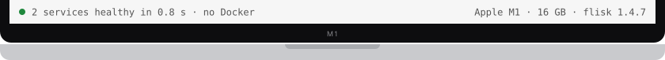

# Frame prototype

## C top outside, bottom row

<!-- tabs:setup macos · generated by scripts/../tabs.mjs from ../tabs.json; edit the panel below, not the bar -->

<table>
<tr><td><a href="../setup/macos.md"></a><a href="../setup/linux.md"></a><a href="../setup/windows.md"></a><a href="../setup/macos.md"></a></td></tr>
<tr><td>

**1. Node.js 22.12+** from [nodejs.org](https://nodejs.org/), plus your app's own runtime. That is all the [simplest path](../start/simplest.md) needs.

**2. For a database, one gateway URL and the same container you deploy**, also start Docker Desktop, OrbStack or Colima, and install Tilt:

```bash
curl -fsSL https://raw.githubusercontent.com/tilt-dev/tilt/master/scripts/install.sh \
  | bash
```

**3. Install Flisk and check the machine:**

```bash
npm install -g @flisk-sh/flisk
flisk doctor
```

`flisk doctor` checks only what your project uses and prints a fix for anything missing. Full steps: [macOS setup](../setup/macos.md).

</td></tr>
<tr><td></td></tr>
</table>
<!-- /tabs:setup -->

## A rows

<!-- tabs:setup macos · generated by scripts/../tabs.mjs from ../tabs.json; edit the panel below, not the bar -->
<table>
<tr><td></td></tr>
<tr><td><a href="../setup/macos.md"></a><a href="../setup/linux.md"></a><a href="../setup/windows.md"></a><a href="../setup/macos.md"></a></td></tr>
<tr><td>

**1. Node.js 22.12+** from [nodejs.org](https://nodejs.org/), plus your app's own runtime. That is all the [simplest path](../start/simplest.md) needs.

**2. For a database, one gateway URL and the same container you deploy**, also start Docker Desktop, OrbStack or Colima, and install Tilt:

```bash
curl -fsSL https://raw.githubusercontent.com/tilt-dev/tilt/master/scripts/install.sh \
  | bash
```

**3. Install Flisk and check the machine:**

```bash
npm install -g @flisk-sh/flisk
flisk doctor
```

`flisk doctor` checks only what your project uses and prints a fix for anything missing. Full steps: [macOS setup](../setup/macos.md).

</td></tr>
<tr><td></td></tr>
</table>
<!-- /tabs:setup -->

## B caption

<!-- tabs:setup macos · generated by scripts/../tabs.mjs from ../tabs.json; edit the panel below, not the bar -->
<table>
<caption></caption>
<tr><td><a href="../setup/macos.md"></a><a href="../setup/linux.md"></a><a href="../setup/windows.md"></a><a href="../setup/macos.md"></a></td></tr>
<tr><td>

**1. Node.js 22.12+** from [nodejs.org](https://nodejs.org/), plus your app's own runtime. That is all the [simplest path](../start/simplest.md) needs.

**2. For a database, one gateway URL and the same container you deploy**, also start Docker Desktop, OrbStack or Colima, and install Tilt:

```bash
curl -fsSL https://raw.githubusercontent.com/tilt-dev/tilt/master/scripts/install.sh \
  | bash
```

**3. Install Flisk and check the machine:**

```bash
npm install -g @flisk-sh/flisk
flisk doctor
```

`flisk doctor` checks only what your project uses and prints a fix for anything missing. Full steps: [macOS setup](../setup/macos.md).

</td></tr>
<tr><td></td></tr>
</table>
<!-- /tabs:setup -->
